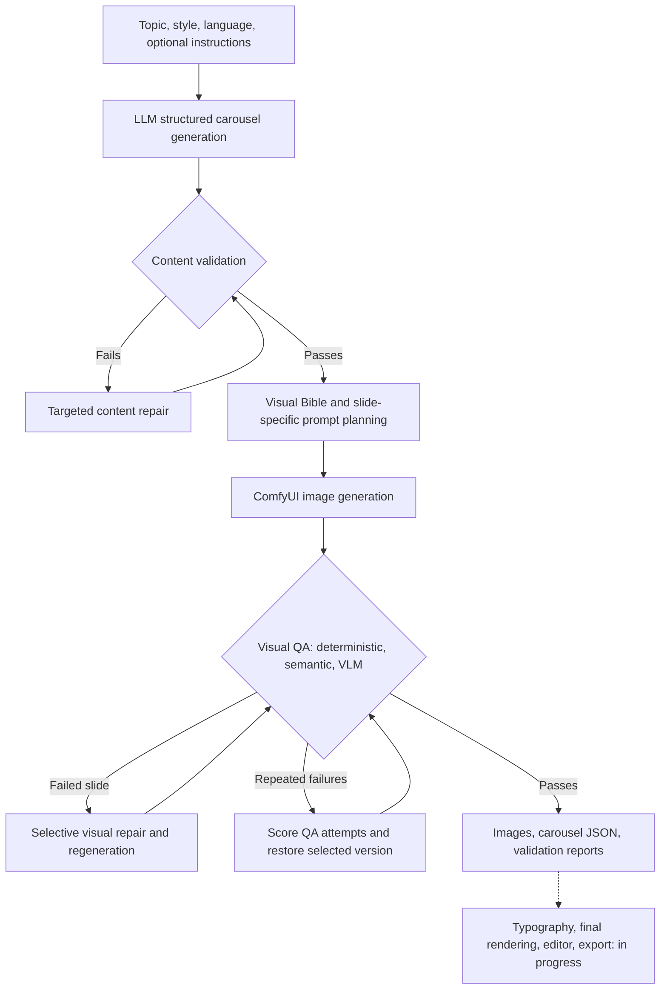

# ARC — AI Carousel Generation with Automated Quality Assurance and Repair

> **Development status:** Research-oriented prototype. Structured content generation, image generation, automated QA, and targeted repair are implemented. Typography, final composition, and publishing/export are still under development. The typography engine is the next target and are under planning

## Overview

ARC is a personal AI engineering project exploring how to make multi-stage generative workflows more controllable and reliable. Given a topic, a style configuration, a language, and optional user instructions, it generates structured content for a multi-slide carousel, produces scene-specific images, evaluates the results, and attempts to repair outputs that fail validation.

ARC is designed around a **generate → validate → diagnose → repair → revalidate** loop rather than relying on a single generation pass.

The current entry point uses predefined test inputs and local model/workflow paths; ARC is **not yet a packaged, one-click end-user product**.

## Pipeline

## Implemented components

### Structured content and style-aware planning

- Creates a structured carousel using a local LLM through Ollama and validates the output with Pydantic models.
- Represents individual slides with a headline, body, narrative purpose, visual direction, composition, and semantic QA target.
- Maintains a **Visual Bible** for shared styling and persistent elements across slides.
- Takes style definitions from YAML configuration, including canvas dimensions, colors, typography preferences, visual mood, and layout constraints.
- Supports language selection in the data model; the current included `minimal_editorial` style defines English and Traditional Chinese typography.

### Content validation and iterative repair

- Checks structure, narrative flow, diversity, progression, element usage, composition, and potential contradictions.
- Combines deterministic rules with model-assisted evaluations, including a transformer-based semantic contradiction check.
- Uses structured issue logs to guide selective slide revisions.
- Revalidates updated content with bounded repair attempts; unsuccessful content repair can restart the overall generation attempt.

### Visual generation and QA

- Constructs visual prompts per slide and calls a local ComfyUI workflow to produce images.
- Performs deterministic image/file checks such as readability, dimensions, and aspect ratio.
- Uses SigLIP-based image–text matching to assess correspondence between a generated image and its target description.
- Uses vision-language model checks for visual components, style consistency, and excessive similarity between slides.
- Classifies visual failures and attempts targeted regeneration or prompt/specification revision as appropriate.

### Asset and resource handling

- Stores extracted visual assets and related metadata; uses semantic matching to select potentially reusable assets for image generation.
- Uses model unloading, CPU/GPU offloading, and cleanup between resource-heavy stages to manage local GPU memory.
- Saves carousel data, visual prompts, image versions, and QA reports as session artifacts for inspection.

### Versioned fallback and recovery (implemented; under testing)

- Saves carousel snapshots (`carousel.json`, `carousel_v1.json`, etc.) and their corresponding visual QA reports (`VisualConsistency.json`, `VisualConsistency01.json`, etc.).
- On repeated failed visual repairs, examines each saved report and assigns an issue-count penalty. An issue listing affected `slide_ids` contributes the number of affected slides; another top-level issue contributes one. The candidate with the **lowest penalty** is selected.
- Uses the selected report's **explicit version number** to identify the corresponding carousel snapshot, rather than depending on filesystem iteration order.
- Reads the selected carousel JSON as the source of truth for which slide images belong to that attempt. This allows a snapshot to contain both unchanged images and images regenerated at different iterations.
- Restores versioned filenames and carousel references, removes obsolete session artifacts, and attempts another visual validation pass.
- The current penalty is a practical heuristic, **not a calibrated visual-quality score**. Recovery still needs regression tests covering the base (`v0`) report, missing files, mixed-version slides, and interruption during file restoration.

## Example: `c_001` visual repair

The repository includes a five-slide carousel session demonstrating validation-driven image revision.

In the initial QA report, slide 4 failed `OVERALL_IMAGE_DESCRIPTION_MISMATCH` with a semantic score of **0.4653**, below the configured threshold of **0.52**. The revised `slideImage_04_v1.png` was subsequently recorded as passing ARC's internal QA checks.

| Original slide 4 | Revised slide 4 |
| --- | --- |
|  |  |

See [session artifacts](carousel_sessions/c_001/) and [QA logs](carousel_sessions/c_001/visual_status/) for the corresponding structured data. **Note:** an internal pass is not independent proof of visual quality or generalizable QA accuracy.

## Project structure

| Directory | Role |
| --- | --- |
| `app/core/` | Content-generation orchestration, model handling, state recovery |
| `app/data_models/` | Pydantic carousel, slide, and style schemas |
| `app/validator/` | Narrative, structure, consistency, and semantic validation |
| `app/fixer/` | Content and visual repair actions |
| `app/visual/` | Visual prompt planning |
| `app/generation/` | ComfyUI integration and image-generation workflows |
| `app/visualQA/` | Image-file, semantic, and VLM-based QA |
| `app/assets/` | Asset metadata, extraction, and semantic retrieval |
| `app/typographyEngine/` | Typography and text-layer work in progress |
| `carousel_sessions/` | Example carousel outputs and QA reports |
| `styles/` | YAML style definitions |

## Technologies

Python · Pydantic · Ollama · Qwen LLM/VLM · PyTorch · Hugging Face Transformers · Sentence Transformers / Cross-Encoder · SigLIP 2 · ComfyUI · Pillow · YAML/JSON

## Running the project

ARC currently requires a configured local development environment (Ollama models, transformer model dependencies, a compatible ComfyUI workflow, and GPU support). Several configuration values and filesystem paths are specific to the original Windows development environment.

**A reproducible installation guide is not yet available.** Before claiming that others can run this repository out of the box, the next steps are to populate `requirements.txt` with tested dependencies, move machine-specific paths into configuration, document the required local models/workflows, and provide a verified example command.

## Development status and roadmap

| Feature | Status |
| --- | --- |
| Structured carousel generation | Implemented |
| Content validation and iterative repair | Implemented |
| Visual Bible and prompt generation | Implemented |
| ComfyUI image generation | Implemented |
| Image-level QA and targeted repair | Implemented; needs broader evaluation |
| Asset retrieval | Initial implementation |
| Versioned fallback and recovery | Implemented with minimum-penalty selection; edge cases under testing |
| Typography and text overlay | In progress |
| Full carousel rendering and editor | Planned |
| Export/publishing workflow | Planned |
| Reproducible setup and automated tests | To be improved |

## What I want to investigate next

- **Repair effectiveness:** How often does targeted regeneration fix a failure compared with regenerating an entire carousel?
- **Validation reliability:** How well do model-based QA scores align with human judgments of visual consistency?
- **Efficiency:** How much time and GPU memory do model offloading, asset reuse, and selective regeneration save?
- **Robustness:** Can state recovery consistently preserve unchanged slides and restore a selected snapshot across multiple failed attempts?

These are research directions, **not completed experimental results**.

## Motivation

ARC began as an attempt to automate carousel content creation. The main technical challenge evolved from generating content into **evaluating and controlling unpredictable generative outputs**. The project is an independent exploration of modular AI systems, structured quality assurance, feedback-driven repair, and resource-aware orchestration.
